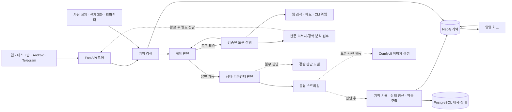

## Overview

캐릭터 페르소나를 가진 AI 컴패니언이자 개인 비서 Agent입니다. 대화에서 기억을 쌓고, 감정과 일상을 유지하며, 상황에 따라 먼저 말을 겁니다. 사용자와 캐릭터의 위치를 독립적으로 관리하는 가상 세계에서 대화와 이미지 공유를 연결했습니다.

기억만으로 답하기 어려우면 웹 검색이나 Codex/Claude CLI 작업 위임을 사용합니다. [투자 비서 Agent](../investment-agent/)·[포트폴리오 Agent](../portfolio-agent/)의 스킬과 읽기용 MCP를 연동해 전문 리서치와 경력 분석을 맡기고, 오래 걸리는 작업은 접수 후 결과를 별도로 전달합니다.

## Demo

## Key Features

### 1. 근거를 보존하는 장기기억
- 응답 후 비동기로 대화의 관측 사실을 추출하고, 기존 엔티티를 식별·연결해 Neo4j에 저장합니다.
- 벡터·전문 검색을 RRF로 결합하여 요약 기억과 원본 관측을 회상합니다. 최근 대화 문맥을 보조 검색에 활용합니다.
- 매일 종료된 기록 기간의 관측을 요약 기억으로 정리합니다. 원본 근거 ID를 유지하고 사실 요약과 캐릭터의 주관적 회고를 구분합니다.
- 현실·가상 경험의 범위와 출처를 함께 보존하여, 가상 세계의 사건을 사용자의 현실 행동으로 혼동하지 않도록 합니다.

### 2. 계획 판단과 도구 실행
- 기본 기억 검색 후 LLM이 답변할지, 도구를 더 사용할지 결정합니다. 도구 결과를 받아 다시 판단하는 루프를 일반 대화와 선제적 대화가 공유합니다.
- 도구는 기억 검색, 웹 검색, 사용자 메모 저장·조회·수정, CLI 작업 위임으로 구성합니다. 메모의 사용자 수정과 AI 제안을 분리합니다.
- 전문 Agent 연동은 백그라운드 작업으로 접수하고 완료 후 전달합니다. 접수를 작업 완료로 취급하지 않습니다.
- 도구 인자를 스키마로 검증하고, 호출 횟수·전체 시간·문맥 크기를 제한합니다. 같은 턴의 동일 호출은 이전 결과를 재사용합니다.

### 3. 선제적 대화와 영속적인 가상 세계
- 최근 대화·기억·수면·활성 상태를 보고 먼저 말을 걸지 판단하며, 응답 속 약속을 추출해 리마인더로 저장합니다.
- 백그라운드에서 캐릭터의 행동·장소·의상을 갱신하고, 월드 이벤트를 대화의 계기로 연결합니다.
- 사용자와 캐릭터의 위치, 가상 세계 입장 상태를 별도로 관리합니다. 같은 장소인지에 따라 대면 상황과 통신창 대화를 구분합니다.
- 생성 도중 새 메시지나 장면 변화가 생기면 전송 전에 재검증합니다. 웹 연결 여부에 따른 전달과 Telegram 미러링을 지원합니다.

### 4. 경량 판단 모델을 활용한 LLM 효율화
- 경량 판단 모델(Jev)이 변경·추출 필요 여부 등을 먼저 판단하고, 복잡한 판단은 LLM으로 넘기는 게이트·캐스케이드 구조를 구현했습니다.
- 노드별로 LLM 단독, 섀도 비교, 신뢰도 기반 채택, Jev 우선 모드를 선택할 수 있습니다. 도구 인자를 생성하는 계획 단계는 LLM이 담당합니다.
- 섀도 모드는 실제 LLM 결과를 유지하면서 Jev와의 일치 여부를 기록합니다. 운영 중 표본 비교와 실패 시 폴백을 지원합니다.
- 비교 일치율은 두 모델의 판단 차이를 확인하는 지표이며, 정답률이나 비용 절감률과 구분합니다.

### 5. 이미지 공유와 멀티 채널 인터페이스
- 최종 응답에 포함된 모습·사진 공유 행동을 해석해, 텍스트 전달 후 ComfyUI 이미지 생성을 비동기로 실행합니다.
- 장면 설명을 태그형 프롬프트로 바꾸고 의상·장소와 결합합니다. Character LoRA와 얼굴·손 디테일러를 적용합니다.
- 생성·전송 전에 장면 변경 여부를 확인하고, 이미지를 대화 이력과 갤러리에 연결합니다.
- 웹(Live2D), Telegram, Tauri 데스크탑·Android 앱이 하나의 대화 세션을 공유하며 응답을 스트리밍합니다.

## Architecture

## Challenges

### 대화가 길어져도 이전 경험을 기억하는 방법

대화 기록을 모두 전달하는 대신, 중요한 사실을 장기기억으로 저장하고 관련된 내용만 검색하도록 구성했습니다. 누적된 기억은 주기적으로 요약하되 원본 근거를 연결해, 요약과 실제 대화 내용을 함께 확인할 수 있게 했습니다.

### 먼저 말을 걸어도 현재 대화의 흐름을 놓치지 않도록

AI가 먼저 보낼 메시지나 이미지를 만드는 동안 사용자가 새로 말하거나 상황이 바뀔 수 있습니다. 결과를 보내기 직전에 현재 대화와 상황을 다시 확인해, 이미 지나간 맥락에 대한 응답을 제어했습니다.

### 모든 판단에 큰 LLM을 호출해야 할까?

기억 저장이나 상태 변경이 필요한지 같은 단순 판단에 경량 모델을 적용했습니다. 기존 LLM과 결과를 비교하는 섀도 평가를 두고, 신뢰도가 낮거나 처리가 어려운 경우 LLM으로 넘기도록 설계했습니다.

## Tech Stack

| 영역 | 기술 |
|---|---|
| AI | Google ADK, Gemini·OpenRouter, Jev, ComfyUI·LoRA |
| Backend | Python, FastAPI, Tavily, Codex/Claude CLI, MCP |
| Data | Neo4j, PostgreSQL |
| Client | TypeScript·Vite·PixiJS(Live2D), Tauri, Android, Telegram Bot |
