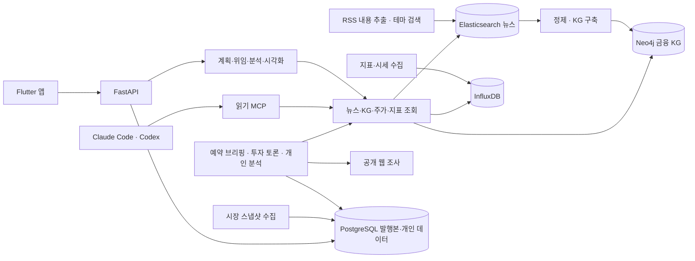

## Overview

주식·경제 질문에 맞춰 검색·데이터 수집·분석·시각화 Agent를 조율하는 투자 비서입니다. 뉴스와 금융 Knowledge Graph, 주가·경제 지표를 근거로 리서치 답변을 생성합니다.

질의응답에 더해 경제·AI 테크 정기 브리핑, 네 관점의 투자 토론, 보유·관심 종목의 일간·주간 분석을 구현했습니다. Flutter 앱에서 채팅, 발행본, 개인 포트폴리오와 시장 현황을 조회하고, Claude Code·Codex에서도 MCP를 통해 저장된 근거를 활용합니다.

## Demo

위 프로토타입은 리서치 채팅의 검색·분석·시각화 과정을 보여줍니다. 브리핑·토론·개인 종목 분석은 아래 구현 설명에 포함합니다.

## Key Features

### 1. 질문에 따른 동적 Agent 조율
- 질문에 주어진 사실과 추가로 조사할 사실을 구분하고 초기 계획을 세웁니다.
- 매 단계 진행 상황·답변 가능 여부·반복 여부를 판단해 다음 Agent에 작업을 위임합니다. 반복 상한과 선행 작업 의존성을 검사합니다.
- 웹 검색, 주가·뉴스 수집, 지식 조회, 분석, 차트 생성을 조합하고 출처와 함께 답변을 스트리밍합니다.
- 대화 세션과 메시지·차트를 저장하여 후속 질문과 과거 리서치 조회에 활용합니다.

### 2. 금융 사실의 시점과 관계를 보존하는 KG
- 회사·지표 등 고유 엔티티와 실적·가이던스 등 시점별 사실을 분리하고 수치·단위·대상 기간을 구조화합니다.
- 기업 거래, 공급·경쟁 관계, 지수·ETF·투자 테마, 실적·경제 일정을 연결합니다. 거시지표와 시세 시계열은 InfluxDB에서 함께 조회합니다.
- LLM이 검증된 읽기 전용 Cypher 템플릿과 인자를 선택합니다. 이름·별칭을 해석하고 질문에 필요한 사실을 짧은 근거 문장으로 반환합니다.
- 동일한 질문 세트로 뉴스 검색 단독, KG 확장, 템플릿 검색을 비교하여 사실 재현율과 컨텍스트 크기를 평가합니다.

### 3. 정기 수집과 경제·AI 테크 브리핑
- Codex 기반 RSS 기사 내용 추출과 Tavily 기반 테마 검색을 분리합니다. 출처·발행 시각·수집 방식을 저장하고 KG 구축 전 정제·중복 선별을 수행합니다.
- 예약 워커가 경제·주식 및 AI·테크 브리핑을 생성합니다. 일간 주요 변화와 주간 시장 흐름을 발행본으로 보존합니다.
- AI·테크 소식은 기업 수요·비용·매출·경쟁 구도와 연결해 정리합니다. 원문 출처와 사실·해석을 구분해 읽을 수 있도록 구성합니다.

### 4. 근거 기반 투자 토론과 개인 종목 분석
- 기술 전환·사업 수익성·수요와 실적·거시 환경을 보는 네 관점이 2라운드로 토론하고, 중립 종합을 생성합니다.
- 주장·반론·응답을 조회 근거와 연결하고 합의·이견을 구분합니다. 단계별 체크포인트로 중단 후 재개와 동일 회차 중복 발행을 제어합니다.
- 보유·관심 종목은 일간 주요 발견과 주간 가설·연결 분석으로 제공합니다. 뉴스·KG·브리핑·토론과 공개 웹 조사를 함께 활용합니다.
- 앱의 시장 화면에는 가격·금리·변동성 등의 저장된 스냅샷을 제공하고, 관측일과 비교 기준을 함께 표시합니다.

### 5. MCP 연동과 사용량 관리
- 읽기용 MCP 도구로 금융 KG, 뉴스, 주가·경제 지표, 브리핑·투자 토론을 조회합니다.
- Claude Code·Codex의 사실 조회·심층 분석 스킬에서 저장된 근거를 수집해 리서치에 활용합니다.
- Gemini 호출별 토큰과 추정 비용을 PostgreSQL에 저장하여 모델·작업별로 집계합니다.

## Data & Storage

| 저장소 | 역할 |
|---|---|
| Elasticsearch | 경제 뉴스와 출처 메타데이터, 벡터·전문 검색 |
| Redis | Agent 작업 메모리, 대화 맥락과 수집·처리 상태 |
| PostgreSQL | 채팅, 브리핑·토론, 개인 포트폴리오·분석, 시장 스냅샷, 사용량 |
| GCS | 리서치 과정에서 생성한 차트 이미지 |
| Neo4j | 금융 엔티티·관계와 시점별 사실 |
| InfluxDB | 거시지표·원자재·통화 시세 시계열 |

## Architecture

## Challenges

### 질문마다 필요한 조사 과정이 달라지는 문제

단순 주가 조회와 여러 기업을 비교하는 질문에는 서로 다른 작업이 필요합니다. 조사 진행 상황에 따라 검색·수집·분석·시각화 Agent를 선택하고, 필요한 자료가 확보되기 전에 분석하거나 같은 작업을 반복하지 않도록 제어했습니다.

### 과거 실적과 현재 전망이 섞이지 않도록

같은 기업에 대한 기사라도 과거 실적, 앞으로의 전망, 진행 중인 계약이 함께 등장합니다. 이를 단순히 모으면 서로 다른 시점과 상태의 정보를 혼동할 수 있습니다.

기업 자체의 정보와 시점별 사실을 분리하고, 수치의 대상 기간과 거래 진행 단계를 함께 저장했습니다. Agent가 답변할 때도 해당 정보가 언제의 사실이며, 확정된 결과인지 전망인지 구분할 수 있도록 구성했습니다.

### 여러 AI의 의견을 검토 가능한 토론으로 만드는 방법

서로 다른 의견을 생성하는 데 그치지 않고, 각 주장에 근거를 연결하고 상대의 반론에 답하도록 구성했습니다. 최종 결과에서도 합의된 내용과 남은 이견을 구분해 판단 근거를 확인할 수 있게 했습니다.

## Tech Stack

| 영역 | 기술 |
|---|---|
| AI | Gemini, Codex, Multi-Agent Orchestration, Graph RAG, MCP |
| Backend | Python, FastAPI, WebSocket, Tavily |
| Data | Elasticsearch, Redis, PostgreSQL, Neo4j, InfluxDB, GCS |
| Infra | GCP, Docker, Cloud Build, cron |
| Frontend | Flutter 웹·모바일 |
