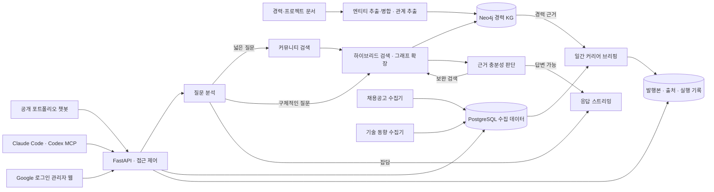

## Overview

이력과 프로젝트 경험을 Knowledge Graph로 관리하고, 질문에 맞는 근거를 찾아 답변하는 포트폴리오 Agent입니다. **이 페이지 오른쪽 아래 챗봇이 실제 서비스에 연결되어 있습니다.** MCP와 스킬을 통해 경력 분석, 이력서 작성과 채용 요건 적합성 분석에도 활용합니다.

채용공고·기술 동향을 독립 수집기로 수집하고, 개인 경력과 연결한 일간 커리어 브리핑을 제공합니다. 관리자 웹에서는 브리핑, 공고, 기술 동향과 수집 현황을 함께 조회합니다.

## Demo

## Key Features

### 1. 경력 문서의 KG 구축
- 엔티티 추출 → 기존 설명 병합 → 저장 → 관계 추출·저장의 Google ADK 워크플로우를 구성했습니다.
- 프로젝트·기술·회사·역할·성과·주제·문제 경험을 정해진 스키마로 추출합니다. 엔티티·관계 추출에는 Pydantic 구조화 출력을 적용합니다.
- 원본 문서와 추출된 엔티티를 연결하고, 같은 타입·이름의 엔티티 설명을 병합하여 추가 경험을 보강합니다.

### 2. 질문 유형과 그래프 구조에 맞춘 검색
- 질문을 분석해 잡담, 전체 경력처럼 넓은 질문, 구체적인 사실 질문의 검색 경로를 나눕니다.
- 엔티티 벡터·전문 검색을 RRF로 결합하고 관계 요약 검색과 Personalized PageRank 기반 확장을 적용합니다.
- Leiden 계층 커뮤니티와 LLM 요약으로 넓은 질문의 진입점을 찾습니다. 이후 근거 충분성을 판단해 최대 3회 검색 루프 안에서 보완합니다.
- PostgreSQL 대화 세션과 이전 턴의 질문 분석 정보를 유지하여 후속 질문의 맥락을 연결합니다.

### 3. MCP 기반 경력 분석과 접근 제어
- Claude Code·Codex에서 사실 조회 스킬과 심층 분석 스킬을 사용할 수 있도록 MCP를 제공합니다.
- 경력·프로젝트 원문 근거를 모아 이력서 작성, 강점·공백 분석, 채용 요건과의 비교에 활용합니다.
- 공개·비공개 데이터 검색 범위와 관리자 전용 분석 모드를 구분합니다. 공개 챗봇과 관리 API의 접근 경로도 분리합니다.

### 4. 채용·기술 동향 수집과 일간 브리핑
- 채용공고 수집기는 공고를 정규화하고 신규·변경·마감 이력을 추적합니다. 공백·목록 순서 같은 표현 차이로 발생하는 불필요한 변경을 억제합니다.
- 기술 동향 수집기는 공개 소스와 웹 검색에서 후보를 찾고 LLM으로 선별·정제합니다. 같은 발표를 가리키는 중복 후보를 통합하고 출처를 보존합니다.
- 수집기는 독립 실행하고 공개 조회용 DB 뷰로 브리핑·조회 서비스와 연결합니다.
- Codex 기반 예약 워커가 이전 발행 이후의 주요 변화, 요구 기술, 개인 경력과의 연결과 다음 행동을 정리합니다. 기술 발견 자료는 조사 후보로 사용하고 원문을 다시 확인하도록 구성합니다.

### 5. 관리자 조회와 운영 관측
- Google 로그인 기반 웹에서 브리핑·채용공고·기술 동향·수집 현황을 검색하고 상세 내용을 조회합니다.
- 핵심 요약과 출처를 먼저 보여주고 수집·진단 정보는 펼쳐 보도록 구성했습니다. 긴 목록과 본문을 각각 스크롤할 수 있습니다.
- 검색 후보의 실제 선택은 Gemini 결과를 유지하면서 경량 판단 모델(Jev)을 백그라운드에서 비교하는 섀도 평가를 구현했습니다.
- 생성·임베딩 호출의 토큰과 추정 비용을 PostgreSQL에 저장하여 모델·처리 단계별로 조회합니다.

## Architecture

## Challenges

### 프로젝트명을 몰라도 경력을 찾을 수 있도록

“어떤 프로젝트를 했나요?”와 “RAG 경험이 있나요?”는 필요한 검색 범위가 다릅니다. 전체 경력을 묻는 질문은 주제별 요약에서 시작하고, 구체적인 질문은 관련 경험과 관계를 검색하도록 나눴습니다. 근거가 부족하면 추가 검색하는 흐름도 연결했습니다.

### 매일 쌓이는 정보를 실제로 읽을 만한 브리핑으로 바꾸기

채용공고와 기술 소식을 그대로 나열하면 같은 내용이 반복되고 중요한 변화가 묻힙니다. 표현만 바뀐 공고와 중복 기술 자료를 걸러내고, 이전 발행 이후의 변화·개인 경력과의 연결·다음 행동을 중심으로 브리핑을 구성했습니다.

## Tech Stack

| 영역 | 기술 |
|---|---|
| AI | Google ADK, Gemini, Codex, Graph RAG, Leiden, PPR, Jev 섀도 평가 |
| Backend | Python, FastAPI, FastMCP |
| Data | Neo4j, PostgreSQL |
| Infra | GCP VM, Docker Compose, Cloud Build, nginx, oauth2-proxy |
| Frontend | GitHub Pages(Jekyll), SSE 챗봇 위젯, 관리자 웹 |
